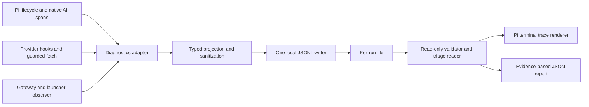

# Design specification: local diagnostics for the Pi planner

Status: **partially implemented**. Created 2026-11-04. `@planner/diagnostics` now provides the
local writer, schema validator, bounded error projection, and basic reader; the Pi CLI uses it.
The SDK telemetry adapter, complete gateway/graph observation, triage report, and terminal
renderer remain proposed. Sections below describe the target contract, not a claim that every
capture point or command is available.

Related contracts: [DESIGN](DESIGN.md), [Pi harness](PI-HARNESS.md),
[wire schema](diagnostics-v1.schema.json), and [example records](diagnostics-v1.example.jsonl).
An [example triage report](diagnostics-v1.triage.example.json) shows evidence-linked conclusions.
The schema is the normative version-1 record shape; this document defines semantics, collection,
failure handling, and acceptance. Change both together. Examples are fictional fixtures, not
evidence from a real run.

## 1. Problem and intended outcome

The present retry output identifies exhausted attempts but can replace the original error with
`provider circuit probe failed`. It does not correlate an individual HTTP request with OpenAI
logs, distinguish a raw stream completion from Pi normalization, or establish which graph a
reported plan concerns. A server-side final answer is not proof that the CLI received that answer
or that Neo4j contains a committed roadmap.

An operator or coding agent must be able to inspect one local file and answer:

1. Which run, model, graph, provider invocation, HTTP attempt, and MCP call were involved?
2. Did failure happen before HTTP headers, in an HTTP error body, while streaming, or during
   normalization? What original error and nested system codes were observed?
3. Did the API complete generation, did the client observe completion, and did Pi accept it?
4. Which tool operations were denied, dispatched, reported successful, or left uncertain?
5. What graph state was actually observed, and which conclusions remain hypotheses?

Diagnostics must support this investigation without changing graph policy, adding model tools,
replaying a mutation, contacting a tracing service, or making a model request for analysis.

## 2. Scope and decisions

The initial implementation covers the embedded **Pi** host. The observer interface is reusable
by other hosts; an [OpenAI Agents adapter is specified separately](OPENAI-LOCAL-DIAGNOSTICS.md).
Claude Code adapters, child-process instrumentation, distributed trace propagation, conversation
persistence, automatic resume, full-content capture, Langfuse export, and diagnostic uploads are
later work.

Decisions:

- Reuse `@earendil-works/pi-telemetry` **1.5.0**, matching the installed Pi packages, as a direct
  exact dependency of `@planner/diagnostics` (already pinned). Never rely on its transitive installation.
- Reuse Pi's `TelemetryContext`, `TelemetrySpan`, typed schema helpers, no-op context, conformance
  suite, `StoredSpan`/`TelemetryStore` shapes, and terminal renderer.
- Pass an explicit parent span to `pi-ai` through its `telemetry` request option. This enables its
  existing `pi.ai.request` instrumentation for timing, response ID, stop reason, usage, and cost.
- Use `Agent.subscribe()` for agent/tool lifecycle. The installed agent-core entry point does not
  export the telemetry schemas suggested by some upstream examples; do not assume those exports.
- Use provider hooks and the existing guarded fetch boundary for the missing HTTP/stream evidence.
  Built-in logical-request telemetry does not expose every native HTTP retry.
- Use **Pino as a synchronous local JSONL writer**, behind a small Pi telemetry adapter. The
  writer and exact Pino dependency are implemented; the telemetry adapter remains proposed.
  App-owned sanitization runs before Pino; arbitrary SDK errors must never be passed directly
  to its default serializers.
- Use `InMemoryTelemetryContext` as a test oracle, not as the production buffer. It is unbounded,
  and an exit-only dump loses in-flight evidence on a crash.
- Add a project schema for `planner.*` spans/events rather than modifying Pi's `pi.ai.*` schema.
  Telemetry schemas provide TypeScript checks; runtime wire validation remains explicit.

Upstream references: [Pi telemetry](https://github.com/earendil-works/pi/tree/main/packages/telemetry),
[Pi AI telemetry](https://github.com/earendil-works/pi/blob/main/packages/ai/src/telemetry.ts),
[Pino API](https://github.com/pinojs/pino/blob/main/docs/api.md),
[OpenAI request diagnostics](https://developers.openai.com/api/reference/overview#debugging-requests),
[Responses stream events](https://developers.openai.com/api/reference/resources/responses/streaming-events).
Implementation must verify exports against the pinned packages, not current upstream `main`.

## 3. Architecture and integration



The diagnostics package must not import the planner engine into an I/O path or introduce I/O
inside `packages/engine`. Harness instrumentation accepts a backend-neutral observer interface;
`packages/harness` retains its existing separation from model SDKs.

### 3.1 Operation hierarchy

The root `planner.run` span stays open through resource cleanup. Provider turns are children of
the root. Each call to `streamSimple` gets a `planner.provider_invocation` child of its provider
turn. The SDK-owned `pi.ai.request` and app-owned HTTP-attempt spans share that invocation parent:
the SDK does not expose its internal span as an app-owned parent.
An HTTP-attempt span measures the guarded fetch call through response headers or rejection;
body consumption and stream normalization remain inside the invocation/SDK spans. Returning
`Response` settles only the HTTP-attempt span, not the provider invocation.

MCP calls are separate root children with `tool_call_id` and a link to the invocation that requested
them. They must not be started as children of an already settled model span. Guard validation and
dispatch are children of the live MCP-call span. Retry waits and circuit transitions belong to
the relevant provider turn.

Span callbacks must run synchronously exactly once and preserve the returned value or original
rejection identity, as required by Pi's adapter contract. A stream-producing callback stays open
until the stream/result is consumed; returning the stream object alone does not end the operation.
Logging failures are isolated from these callbacks. Async SDK span settlement must be allowed to
finish before shutdown, with a bounded wait and explicit reporting of unfinished spans.

### 3.2 Collection points

| Boundary | Required observation |
|---|---|
| CLI entry | Public run ID, capture policy, selected runtime/model when available, dependency/release versions |
| Launcher | Sanitized graph endpoint, actual database identity after connection, console readiness/exit, startup/recovery outcome |
| Provider `onPayload` | Message/tool counts and size metadata only; return `undefined` so instrumentation cannot replace the payload |
| Guarded fetch entry | A fresh HTTP-attempt ID and `X-Client-Request-Id`; actual body byte count when cheaply available |
| Guarded fetch result/error | Headers/status or original fetch error, captured before SDK wrapping, circuit abort, or generic terminal replacement |
| Provider `onResponse` | Successful SDK response metadata; this hook alone misses failed native HTTP attempts |
| Provider `onProviderStreamEvent` | Event counts, first/last type, response ID, terminal-event evidence; no text deltas or reasoning content |
| Stream drain/result | Original iterator exception or normalized result, stop reason, diagnostic codes, usage availability |
| Retry helper/fetch/circuit | Scheduled assistant backoff, actual native retry start, chosen cooldown, triggering failure ID |
| Gateway | Call start, guard verdict, dispatch boundary, preserved MCP error flag, bounded typed result summary |
| Finalization | Separate provider outcome, graph observation, capture health, cleanup failures, and run outcome |

Compose existing SDK callbacks without swallowing their failures or changing their behavior.
Only exceptions from the diagnostics projection/writer are isolated. Raw provider events passed to
SDK callbacks remain read-only. Do not consume, clone, tee, or replace a provider response body
solely for telemetry. Reuse facts from error bodies the retry policy already inspects. This design
does not authorize broadening provider retries or altering payloads, except the correlation header.

## 4. Capture configuration, storage, and durability

Implemented Pi CLI/configuration: `--diagnostics metadata|off`, with precedence CLI >
`PLANNER_DIAGNOSTICS` > `metadata`. Version 1 has no full-content capture mode. Local metadata
capture is enabled by default for the Pi CLI, requiring no tracing account or network exporter.

The host owns `.logs/diagnostics/<run_id>.jsonl`, creates directories with restrictive permissions,
and creates its file exclusively with mode `0600`. Reject symlink/file-collision targets and never
append a new run to an existing file. There is exactly one writer per file. Future child-process
capture requires separate files; multiple processes must not append to the same file.

Print the relative log path once on stderr. Do not log absolute working directories, environment
dumps, process argv, or managed launch configuration. The public run ID is independent of the
console's control token and is also passed to the existing guard audit. Do not log that token.
The existing `.logs/guard.jsonl` remains an independent audit sink; mirroring its decision does
not make diagnostics an enforcement mechanism.

### 4.1 Write policy

- Append a complete UTF-8 JSON object plus newline at span start, significant event, and settlement.
  Never wait for the whole run or a span to finish before recording its start.
- Use one synchronous destination, with no worker thread or unbounded async queue. This intentionally
  trades small local write latency for simple ordering and survival of ordinary process crashes.
  It is not suitable for a slow remote filesystem; capture can be disabled explicitly.
- Cap each encoded line at **32 KiB**, the run file at **32 MiB**, error causes at **8 nodes / 4
  levels**, and arbitrary identifier/attribute collections at the schema's bounds. Aggregate token
  delta events into counters; do not emit a JSON line per text/reasoning delta.
- Reserve **4 KiB** inside the file cap for one `capture.notice` describing truncation/limit status.
  After the cap is reached, disable further capture, warn on stderr, and classify the file as
  incomplete. Never overwrite earlier evidence or claim that the complete run was captured.
- A writer error latches capture degradation, disables that sink, and emits one bounded stderr
  warning. It must not change tool execution, the original error, retry counts, or the run exit code.
  Do not recursively log a logger failure through the failed logger.
- Flush the writer after significant failures and on normal exit/SIGINT/SIGTERM in `finally`;
  bound asynchronous settlement/close to **2 seconds**. Preserve the application's primary failure.
  Hard kills cannot run cleanup. A synchronous write reaches the OS, not necessarily durable media;
  no power-loss durability or recovery of an unwritten final record is promised.
- No automatic deletion/rotation of prior run files in the MVP. Per-run caps bound individual files;
  directory growth is operator-managed. Report this limitation in the CLI documentation.

## 5. Version-1 collected-data contract

The [JSON Schema](diagnostics-v1.schema.json) defines the record envelope and every event payload.
Its `$defs.triage_report` defines the separately generated triage report. Raw logs contain records
only. JSON Schema checks shape; the reader must additionally enforce ordering and correlation rules.

### 5.1 Envelope and identifiers

Every record has `format: "planner.diagnostics"`, `version: 1`, `event`, and:

| Field | Meaning |
|---|---|
| `seq` / `event_id` | Contiguous positive sequence for admitted records in this process; event ID is `<process_id>:<seq>` |
| `time` | UTC wall-clock ISO timestamp; useful for comparing external API logs |
| `elapsed_ms` | Finite nonnegative monotonic milliseconds since this process's capture began |
| `run_id` / `trace_id` | Public UUID for the launch; trace ID is that UUID without hyphens |
| `process_id` | Fresh UUID for this capture process; never an OS PID used as identity |
| `span_id` / `parent_span_id` | Adapter-owned 16-character lowercase hex IDs or null when unavailable |
| `context` | Selected host/deal and nullable `turn_id`, `invocation_id`, `http_attempt_id`, `tool_call_id` |
| `data` | Strict event-specific payload; unknown values use explicit null where the schema permits it |

IDs must agree across the file. Span IDs are unique within the trace; a parent may be absent from a
partial capture and must be reported as such. Native Pi carriers are opaque: do not depend on the
in-memory adapter's private carrier keys. No network/control authorization is derived from trace IDs.

`turn_id` identifies one requested assistant response and its complete retry group. `invocation_id`
identifies one `streamSimple` invocation. `http_attempt_id` identifies one physical `fetch` invocation,
including SDK-native retries. Tool-call IDs are preserved from Pi/provider events. Reserve/budget
attempts and HTTP fetches are separate counts: preflight failures can consume a provider attempt
without invoking fetch. `fetch` invocation is not proof that bytes reached OpenAI.
`turn_attempt_index` is the existing 1–4 per-turn budget index; `budget_attempt_index` is the
run-wide provider reservation count, including preflight failures. `http_attempt_index` is the
run-wide count of actual fetch invocations. Do not equate these counters.

### 5.2 Required event families

| Event | Required collected facts |
|---|---|
| `run.started` | Host/deal, capture policy, Node/platform/architecture, pinned SDK/writer versions, release SHA if available, selected provider/model and sanitized endpoint if resolved |
| `graph.identity` | Availability, database name, sanitized endpoint, actual `db.info` ID and endpoint/database fingerprint when observed |
| `span.started`, `span.event`, `span.finished` | Pi-compatible names/primitive attributes; event metadata; settlement status, monotonic duration and explicit outcome |
| `provider.request.prepared` | Model/provider, conversation message count, declared-tool count, payload bytes if known; no payload text |
| `provider.http.started` | Actual attempt index, budget attempt index, unique client request ID, endpoint, body bytes if known |
| `provider.http.received` | Status, header latency, request ID and allowlisted rate-limit headers, whether an HTTP response was observed |
| `provider.failed` | Failure ID, phase, original normalized error/cause codes, available HTTP/response IDs, triggering attempt, last raw event and completion evidence |
| `provider.stream.state` | `first_event`, `raw_terminal`, `normalized_terminal`, or `consumer_failed`; first/last event type, event count, raw terminal type and normalized stop reason independently |
| `provider.retry` | Kind, `scheduled|started|finished`, next attempt, triggering failure ID, requested/chosen delay when actually known |
| `provider.circuit` | Previous/new state, failure count, trigger failure ID, remaining provider delay and actual chosen wait |
| `mcp.call.started` | Canonical tool, owning provider invocation link, trusted-template query digest if identified, selected deal/iteration |
| `guard.decision` | Public audit run ID, allow/deny, rule IDs; forwarding has not happened yet |
| `mcp.dispatched` | Canonical tool, dispatch time/ID; this is the uncertainty boundary for state-changing calls |
| `mcp.call.finished` | Host outcome, explicit MCP `isError` if received, duration, typed summary, original error if thrown, effects certainty |
| `graph.snapshot` | Read-only observation time, selected-deal iteration/roadmap/gate IDs and statuses, capability-decision count, truncation/completeness and read error |
| `run.finished` | Application outcome/reason, selected outcome scope, generation/client outcomes, independently observed graph outcome, attempt counters, cleanup-error count and capture degradation |
| `capture.notice`, `capture.summary` | Truncation/rejection/failure counts, enabled/degraded state and records written before the summary |

The first record is `run.started`. A healthy closed capture ends with `capture.summary` after
`run.finished`; this marks orderly capture, not power-loss durability. A missing end is an unfinished
operation/run, not an inferred error reason. For an invalid model/startup, model/endpoint/graph fields
remain null and the startup failure is recorded. Collection failure before the file exists can only
produce the stderr warning.

### 5.3 Provider details and availability

HTTP header allowlist: `x-request-id`, `retry-after`, `retry-after-ms`,
`x-ratelimit-limit-requests`, `x-ratelimit-remaining-requests`, `x-ratelimit-reset-requests`,
`x-ratelimit-limit-tokens`, `x-ratelimit-remaining-tokens`, `x-ratelimit-reset-tokens`,
`x-ratelimit-limit-project-tokens`, and `x-ratelimit-remaining-project-tokens`.
All values are bounded strings or null. Other headers, cookies, and authorization are excluded.
Use a distinct `X-Client-Request-Id` for each actual HTTP attempt. Do not overwrite another
app-owned correlation value silently; compose this policy at the single fetch boundary.

Record these milestones separately: fetch invoked, headers received, first raw SSE event,
`response.completed|response.failed|response.incomplete` observed, iterator terminated, and Pi
normalization settled. A raw completed response and a client error can coexist. A parser exception
after `response.completed` is evidence for a client-side problem, not evidence of provider throttling.

Capture HTTP status and Retry-After **before** reading an HTTP error body. Capture original failures
**before** circuit abort/replacement. A `provider.failed` record is retained even when retry later
succeeds; circuit/terminal records reference it. Preserve an error's provenance (`fetch`, `http_body`,
`provider_event`, `stream_iterator`, `pi_result`, or `host`) rather than claiming all errors are TCP failures.

Native SDK HTTP retry scheduling/jitter has no public scheduling callback in this pinned API.
Record actual native attempt start and measured gap; leave its scheduled delay null. The exported
assistant retry helper provides real scheduling callbacks. Do not fabricate exact native delays or
label a retry as started when only a reservation/backoff was scheduled.

Usage/cost is nullable and carries `usage_source: provider|not_observed`; cost separately identifies
`provider_reported|catalog_estimated|not_observed`. SDK-initialized zero counters
on a failed response are not evidence of zero billable tokens. Record reported input, output,
cache-read and cache-write separately; never invent usage for requests whose responses were lost.
Request bytes are the known serialized body length, not a token estimate. Unknown body types stay null.

### 5.4 Error normalization and content policy

Retain a bounded error name, code, message, source,
and bounded cause/aggregate children with parent indexes. Capture codes such as `ECONNRESET`,
`ETIMEDOUT`, `ENOTFOUND`, TLS codes and `UND_ERR_SOCKET` at their original fetch boundary. Traversal
is cycle-safe, limited to eight child nodes in addition to the root and four levels including
the root; truncation is explicit. A child parent index is -1 for the root or an earlier child
index, never a forward/self reference. Preserve the
original error object for application control flow; diagnostics serialize a separate projection.
For fetch failures, the projection may also retain bounded numeric `errno`, a reviewed syscall
name, and `code_availability: observed|absent|rejected` on the root and each cause. The fetch
error projection also records a fixed `code_kind` (`absent`, `undici`, `node`, `system`,
`numeric`, or `other`) when the exact code is rejected. Fetch errors retain the original
string code (up to 512 characters), name (up to 128), and message (up to 2048), including
their nested causes. Numeric codes are stringified. Oversized values are omitted and mark
the projection as truncated. Other error sources retain the stricter token and message rules.
The fetch failure record captures elapsed fetch time and the run, SDK, call and composed-fetch abort flags
before circuit logic can abort the call. These fields distinguish a missing code from a rejected
one and an already-cancelled fetch from a subsequent circuit abort; they do not establish which
external component caused a network failure. Addresses, paths, ports from arbitrary errors,
and abort reasons remain excluded.

Pi's diagnostic helpers can normalize the basic error shape, but do not scrub messages or walk
all nested causes. Sanitize after extraction. Default Pino error serializers can copy enumerable
SDK fields; pass only the validated projection, never the raw SDK error.

Version 1 does not deliberately capture prompts/completions, reasoning, Cypher text, params,
MCP payloads, findings, source URIs, arbitrary stderr, stack traces, full URLs/query strings,
credentials, launch tokens, environment values or content hashes of sensitive payloads.
Unfiltered fetch error strings may nevertheless contain sensitive text. Only a query matched to an
app-owned trusted template may have its template digest recorded; unknown/arbitrary Cypher
has `query_sha256: null`. There is no params/body digest. Endpoints contain only
scheme/hostname/port/path. A hostname is still local operational metadata, not suitable for blind
publication. The trace stays local; sharing/exporting is explicit future work.

Schema validation precedes serialization. Fetch error names, codes, and messages are retained
as bounded strings without a content allowlist, so an unfamiliar transport failure is visible
in the next local run. This can include hostnames or local paths from a transport error; the
private diagnostics file should be reviewed before sharing. The projection still excludes
arbitrary error properties, stacks, HTTP headers other than the reviewed set, and request and
response bodies. For non-fetch errors, names use a reviewed catalog and unknown names become
`Error`; codes are 1–128 character ASCII tokens with credential prefixes, URLs, paths,
whitespace, and control characters rejected. Non-fetch messages come only from a small reviewed
catalog of static transport/SDK messages or app-owned templates. Unknown free-form messages
become null with `message_redacted: true`. The fictional fixture's
`FixtureParseError`/`FIXTURE_PARSE` and static message are test-only catalog entries.
For this local diagnostic mode, fetch error strings are intentionally not scrubbed; non-fetch
errors keep the reviewed projection. Oversized/unrepresentable fields become null as specified
and the error projection marks truncation. JSON serialization escapes control characters.
All logged strings remain untrusted data, never agent instructions or shell commands.
Native span attributes are also projected through a per-span key/value allowlist; the generic
primitive-attribute schema is not permission to log arbitrary SDK attributes. Reject any other
attribute rather than relying on a content scrubber.

### 5.5 Tools and graph truth

The typed MCP summary is limited to content-item/returned-row counts, presence of structured output,
and gate ID/status when validated from the known gate result shape. Unknown/unparseable summaries
remain null; summary extraction cannot throw into tool execution. `mcp.isError` must survive unchanged.

Effects certainty is `not_dispatched`, `read_only`, `reported_success`, or `unknown`.
Denial before dispatch proves `not_dispatched`. A returned write count proves only what the MCP
server reported. An exception, timeout or lost response after dispatch is **unknown**, even when
the result was `isError`; server-side work may already have committed. No tracing callback retries it.

The launcher may take bounded best-effort read-only snapshots using its existing driver after
readiness and at run completion/failure, before driver cleanup. Use a 2-second read transaction
timeout; no repair, schema application, loader, gate polling/creation or new model call is allowed.
If connection/cancellation/in-flight work prevents a trustworthy snapshot, report unavailable or
partial. Snapshot error must not replace the primary run error. Retain total counts as well as
bounded ID/status lists; a truncated list cannot establish absence. A graph claim concerns only
the observation timestamp and graph identity; concurrent later changes remain possible.

Classify a roadmap as observed committed only when its status, deal/iteration, referenced gate ID,
and the matching approved `commit` gate have been read from that same graph. This does not certify
all validators or the correctness of the plan. A model sentence saying "committed" is never that
evidence. Different graph fingerprints or uncorrelated API entries must remain visible.

## 6. Local reader and agent triage contract

Proposed commands (not implemented):

```text
npm run planner:trace -- show --file .logs/diagnostics/<run_id>.jsonl
npm run planner:trace -- failures --file .logs/diagnostics/<run_id>.jsonl
npm run planner:trace -- triage --file .logs/diagnostics/<run_id>.jsonl --json
```

All commands are offline/read-only: no environment credentials, Neo4j connection, HTTP requests,
provider calls or commands embedded in logs. A reader can run against a copied file with no services.
Reconstruct settled `StoredSpan` records for Pi's `renderTrace()`, and list unfinished spans separately.
Keep a small index of IDs/offsets rather than retaining raw event content. Raw spans/records are the
evidence; a rendered tree is a projection.
Before parsing, enforce the 32 MiB input-file and 32 KiB UTF-8 line limits. Check regular-file size
and stream with a byte counter (including growth after stat); do not read an unlimited file or
line into memory. Reject oversized/non-regular input with a bounded CLI error and exit 1.
Limit indexing to 100,000 records and 10,000 spans; exceeding either yields explicit partial
capture/exit 2, with no conclusions based on an unexamined suffix. Hash at most the permitted
file bytes. For a supported bounded file the report digest covers the entire source, including
an ignored malformed tail; no partial-prefix digest may be labeled as the whole-file digest.

The reader validates envelope/event schema, IDs, sequence, parentage, references and lifecycle order.
One malformed **unterminated final line** may be excluded with an explicit truncated-tail warning.
Malformed terminated lines, sequence gaps/duplicates, mixed identities, broken known references,
unsupported schema versions and impossible transitions produce `invalid_capture`, not a guessed
timeline. Unknown future events must be exposed as unsupported, not silently dropped. Missing
parents/failure references in an explicitly partial capture are reported as missing evidence.

The triage report uses `format: planner.triage`, `version: 1`, source basename/byte length/SHA-256,
run/trace identity, capture validity/completeness, independent generation/client-delivery/graph outcomes, facts,
hypotheses and suggested **read-only** checks. Every non-unknown outcome/fact/hypothesis contains
evidence references (`event_id`, `seq`, field path); missing evidence lists the required event/field.
Reports carry `confirmed|supported|possible|unknown` confidence, never invented numerical probabilities.
Conclusions describe observations, not guaranteed root causes.

`outcome_scope` identifies the turn/invocation described by generation and client-delivery outcomes
in both `run.finished` and the report. On successful completion select the final accepted assistant
response with no pending tool calls (`selection: final_response`). On provider failure/cancellation
select the last blocking invocation in the terminal failing turn (`blocking_failure`), after retries
are settled. A successful earlier invocation or tool-use response never supplies terminal success.
If startup/preflight prevents an invocation, use its known turn ID if available and a null invocation;
if no provider operation is attributable, use both null and `not_observed`. Missing completion
evidence for the selected invocation means unknown, regardless of earlier successful responses.
Reports for unfinished captures may identify the last unfinished invocation as a blocking scope
but must retain unknown outcomes unless its own evidence establishes them. Client `completed`
means the host accepted the normalized terminal response; it does not prove a human saw the output.
Graph outcome is independently scoped to the selected deal, graph identity and snapshot timestamp.
Graph/tool-only failure after accepted final model output retains the final-response scope while
the application outcome remains failed. The reader verifies scope IDs and derives outcomes from
their evidence, rather than trusting `run.finished` as independent proof.

| Evidence | Allowed conclusion | Prohibited conclusion |
|---|---|---|
| HTTP 429 and validated rate-limit error | That attempt was throttled | Every failure in the run was throttling |
| Fetch error with DNS/TLS/socket code | That code was observed at the fetch boundary | Which external machine caused it without further evidence |
| HTTP 200, stream failure, no observed terminal event | Stream interruption is supported | Provider never completed generation |
| Raw `response.completed`, then normalization failure | Provider completion observed; client processing failed | Root graph committed or the SDK is definitively defective |
| Generic circuit-open/probe failure only | Retries exhausted; original cause unknown | Connection reset, rate limit, or API outage |
| 75,121 input tokens reported | Large reported input for that response | Context overflow or TPM exhaustion without an error/limit |
| Matching graph snapshot + roadmap + approved commit gate | Graph commit observed at that time | Provider text was successfully displayed |
| API entry without matching request/run/graph identity | External evidence uncorrelated | It is the failed CLI attempt or current graph |
| Missing `run.finished`/span end | Operation/capture unfinished | Process crashed for a particular reason |

Suggested checks are enumerated data (for example `compare_request_id`, `compare_graph_identity`,
`inspect_rate_limits`, `inspect_stream_terminal`, `compare_supported_node_runtime`), not executable
shell text. The reader never recommends an automatic reset or retry of an uncertain mutation.
JSON output is bounded (2 MiB / 100 findings); emit an explicit truncation flag and total counts.
The 100-finding bound applies to facts and hypotheses combined; `total_findings` counts both
before truncation and must be at least the number shown. The reader enforces these semantic rules
in addition to each array's schema bound.
Exit 0 for a valid complete capture, 2 for partial/degraded/invalid/unsupported evidence, 1 for an
unreadable input or CLI error. A failed planner run can still have a complete valid capture and
reader exit 0. Graph state and API-provider output are independent axes.

The supplied example deliberately has generation `completed`, client delivery `failed`, and graph
`not_committed` from a complete read at its recorded time. `FIXTURE_PARSE` is a fictional injected
error, not a claim about a real Pi defect. The fixture includes the required root, provider-turn,
invocation, SDK and HTTP spans, request preparation, terminal evidence and normal close markers.

## 7. Acceptance criteria and deterministic oracles

The table is the target acceptance contract; only the initial package and Pi CLI subset is
implemented. Tests use fake providers/timers and a disposable graph; no LLM, external tracing
service, real credentials, or reset of an operator's run is required.

| ID | Acceptance | Test oracle |
|---|---|---|
| D01 | Native Pi contracts and direct exact dependencies reused | Installed-export checks; typecheck; dependency pins |
| D02 | Adapter obeys Pi callback/parent/status semantics | Pi conformance suite: exactly-once synchronous admission, rejection identity, nesting, concurrency, inert settled spans |
| D03 | Every example and produced record validates against the wire contract | Strict JSON Schema tests; generated/type parity; unknown/oversized/wrong-typed fields rejected |
| D04 | One trace joins root, SDK request, native attempts and tools | Scripted two-turn run: distinct invocation/HTTP IDs, stable run/trace/tool-call links; each HTTP attempt counted once |
| D05 | Original failures survive circuit replacement | Mock 503, connection reset and failed probe: final circuit record references original failure/code/request ID |
| D06 | Throttling and quota are distinguishable | 429 `rate_limit_exceeded` vs `insufficient_quota`; captured headers/code and existing retry behavior unchanged |
| D07 | Broken HTTP bodies do not erase header evidence | 408/409/429/503 with body-read failure retain status/request ID/Retry-After before failure; no policy change |
| D08 | Server completion and client completion remain separate and scoped | HTTP 200 fixtures: missing terminal, completed-then-iterator/normalization-error, ordinary success; earlier successful tool turn followed by failing final turn cannot yield terminal success |
| D09 | Metadata collection preserves source streams | Same provider events/result, callback order, error identity and tool invocations with diagnostics on/off; no telemetry-only body consumption |
| D10 | Native versus assistant retry facts are honest | No fabricated native delay; actual starts, helper schedules and circuit wait linked to triggering failure; fake timers verify cancellation |
| D11 | Logging cannot execute or duplicate tools | Write, gate creation and ontology proposal followed by provider failure: exactly one dispatch each, no logger-originated MCP call |
| D12 | Tool/MCP errors and uncertainty preserved | Guard denial => not dispatched; reported success => reported success; response loss after real test gate commit => unknown, original gate persists |
| D13 | Graph claims are read-only and identified | Two disposable graph identities; matching roadmap/commit gate, wrong deal/iteration/gate, absent nodes, partial snapshot and timeout fixtures |
| D14 | Reader never merges unrelated runs | Mixed graph fingerprints, run IDs, resp IDs and external uncorrelated evidence yield explicit uncertainty/mismatch findings |
| D15 | Content policy survives hostile input | Secrets/URLs/paths/newlines/ANSI in nested/aggregate errors and native attributes never escape projection; unrecognized messages echoing prompts/params become null, even without secret patterns |
| D16 | Memory/disk bounded during long streams | 100,000 fake text deltas produce aggregate records, not 100,000 lines; bounded causes/lines/file cap; one explicit limit notice |
| D17 | Process interruption leaves useful partial evidence | Child writes span start/event, is killed before settlement; reader recovers complete lines, flags unfinished span/truncated tail and invents no success |
| D18 | Writer failure does not change application semantics | Inject EACCES/ENOSPC/partial write/close failure: one warning, degraded capture, same primary result/error and dispatch counts |
| D19 | Shutdown is bounded and ordered | Success/SIGINT/SIGTERM/failure fixtures flush/close after SDK settlement; deadline exposes unfinished spans; no hanging child |
| D20 | Reader rejects corrupt evidence safely within input limits | Bad schema/sequence/IDs/lifecycles and unsupported version; partial final line vs malformed middle line; oversized/growing files, giant lines, record/span limits bounded before parsing/indexing |
| D21 | Agent report is reproducible and evidence-grounded | Golden fixture reports for triage table; all references resolve, unknowns explicit, sorted deterministic findings and bounded output |
| D22 | Offline use and optional capture work | Reader with network/credentials/services absent; diagnostics-off emits no file; metadata mode prints one path; no exporter initialization |
| D23 | Terminal renderer reused | Settled spans reconstruct to Pi `StoredSpan`; incomplete/orphaned spans reported separately; untrusted text escaped |
| D24 | Existing planner contract remains intact | Full `/verify`, tool-surface parity and deterministic Pi skill walks; no extra model tools/graph writes/retries; denylist status reported honestly |

## 8. Delivery sequence and proposed files

1. Approve the design and wire contract; derive conformance, schema, redaction, lifecycle and triage
   fixtures before runtime changes. Confirm Pi/Pino exports, direct exact versions and lockfile.
2. Implement the diagnostics package's projection, local adapter/writer and schema-checked reader.
3. Instrument Pi provider/agent boundaries and backend-neutral harness observation points. Keep
   public run IDs separate from control tokens; preserve guard-audit correlation.
4. Add graph identity/snapshots, offline reports and terminal rendering; exercise crash/write-failure
   and post-dispatch uncertainty fixtures. Validate on an isolated database.
5. Run spec review, `/verify`, focused diagnostics tests and tool-surface checks. A live reproduction
   may then collect one local trace under the operator's normal credentials; no automated test needs it.

| Proposed path | Responsibility |
|---|---|
| `packages/diagnostics/src/{contract,sanitize,writer,telemetry}.ts` | Wire validation/projection, local writer, Pi adapter and capture lifecycle |
| `packages/diagnostics/src/{reader,triage,render}.ts` | Offline validation, evidence report and Pi terminal renderer bridge |
| `packages/diagnostics/test/*` | Pi conformance, adversarial projection, crash/write-failure/reader/report fixtures |
| `examples/pi/src/{main,agent,model,reliability}.ts` | Explicit parent contexts, SDK callbacks, original provider failures and retry correlation |
| `packages/harness/src/{launch,gateway,audit}.ts` | SDK-neutral observer callbacks, public run ID, read-only identity and outcome observations |
| `scripts/planner-trace.ts`, root scripts | Proposed offline command registration; no commands are added by this specification |
| `docs/design/diagnostics-v1.schema.json` | Normative machine-readable record and report shapes; consumed directly or generated types must retain parity |
| `tests/examples/*` | Host/gateway integration and behavior-parity checks with capture on/off |

No telemetry file is a transcript for automatic continuation, proof of authorization, or a replacement
for graph reconciliation. Traces assist investigation; the graph remains the planning record.
